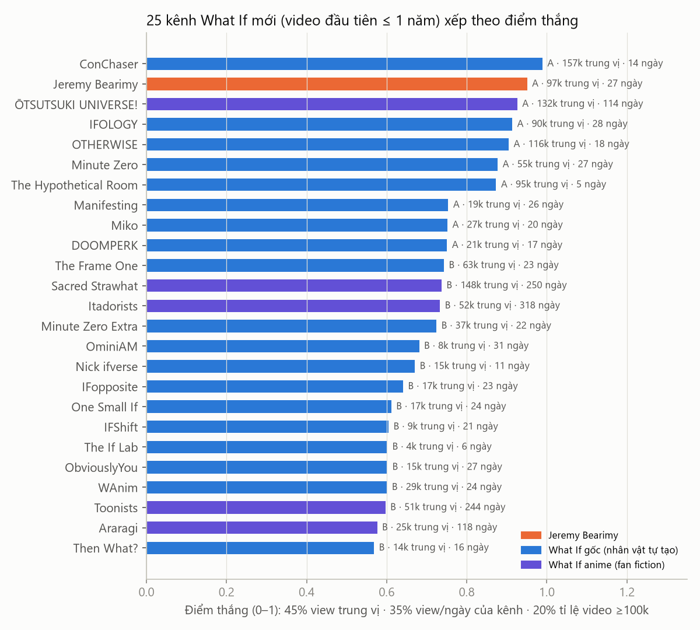
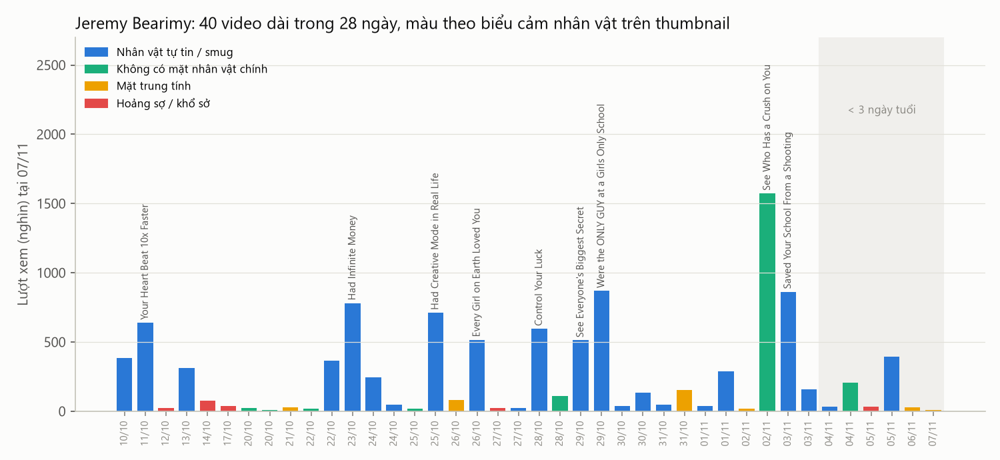
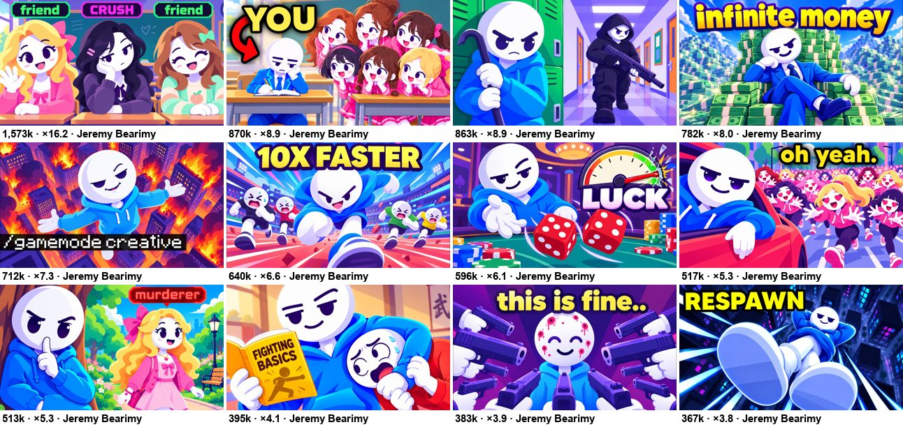
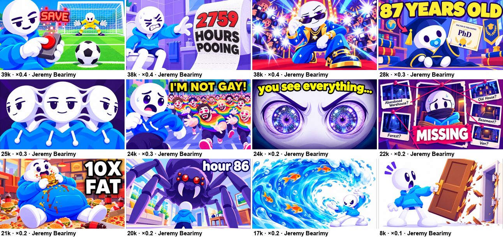
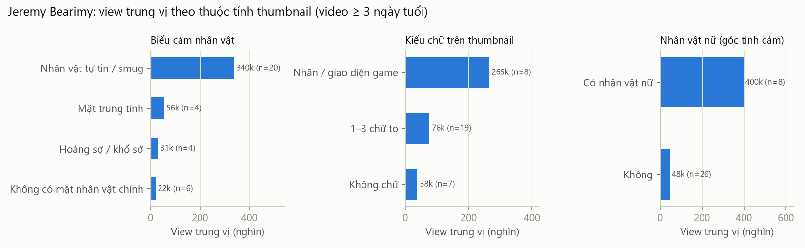
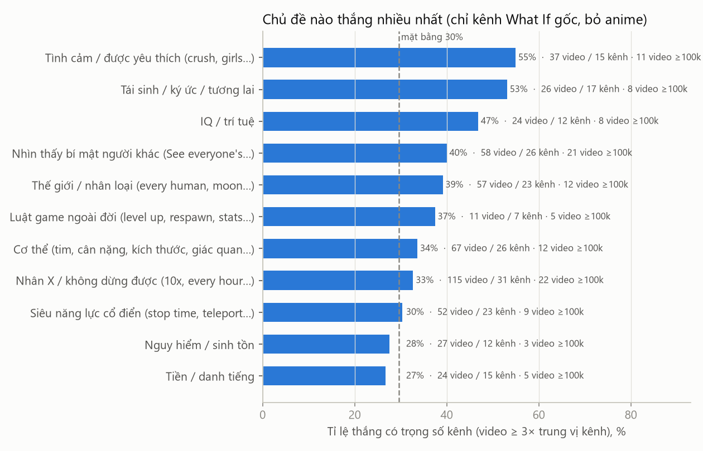
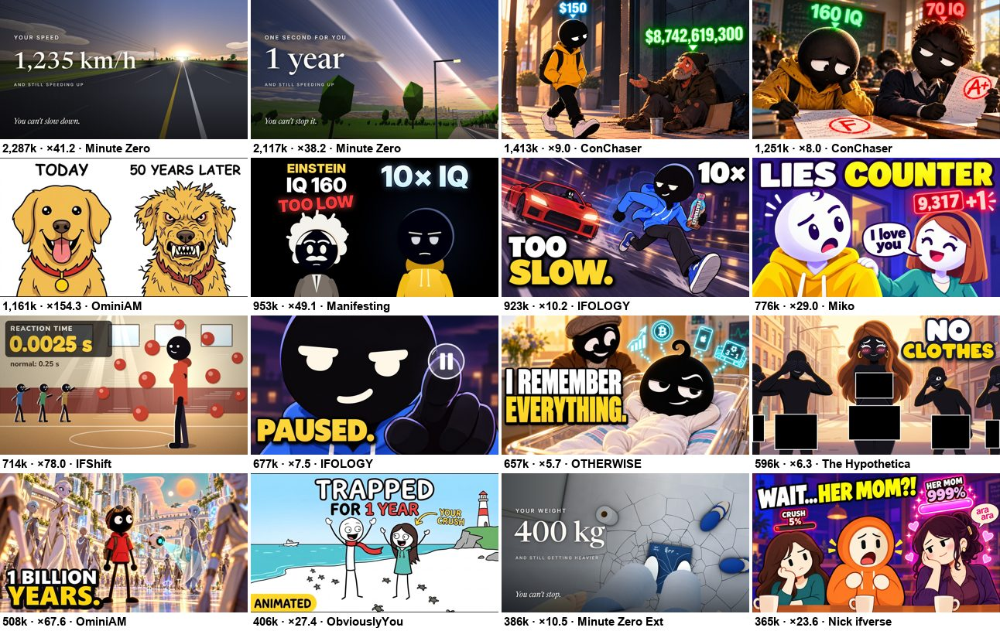
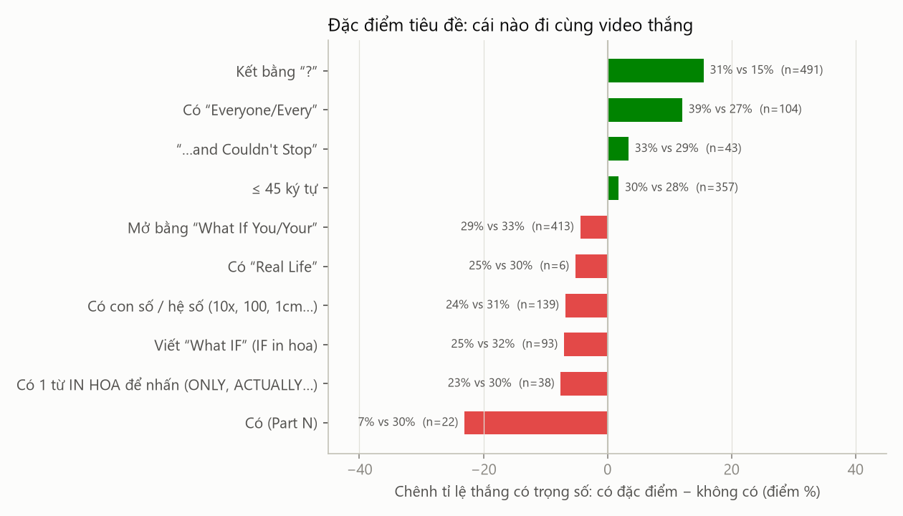
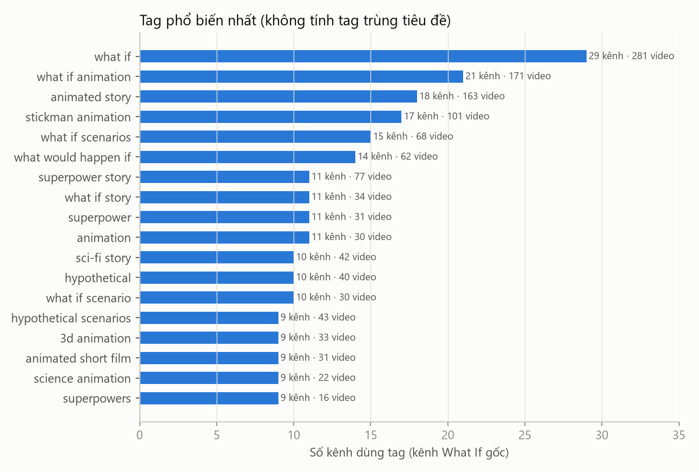
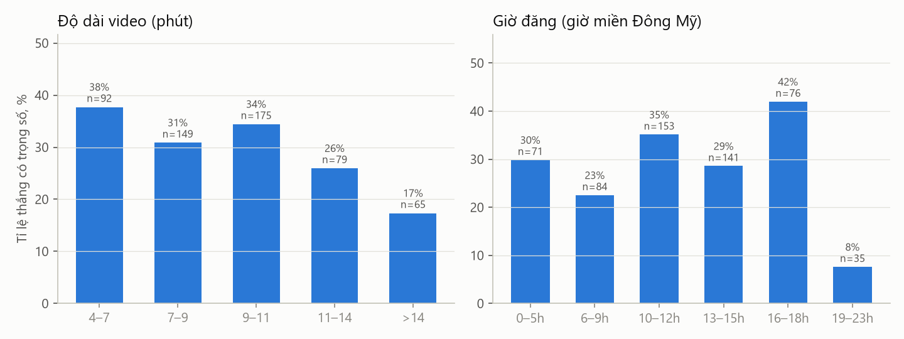

# Báo cáo đối thủ What If: chủ đề, thumbnail, mô tả, tags (07/11/2026)

| | |
|---|---|
| Ngày lập | 2026-11-07 |
| Phạm vi | Kênh What If tiếng Anh, thị trường Mỹ, **video đầu tiên đăng trong vòng 1 năm** (kênh cũ nhất: 318 ngày) |
| Dữ liệu | Snapshot YouTube Data API 06/11 (nhánh `research/reports`, `data/2026-11-06/`) · **Jeremy Bearimy lấy mới ngày 07/11** bằng yt-dlp (view, tags, mô tả, chương, thumbnail) |
| Cỡ mẫu | 51 kênh có ≥ 3 video dài · 793 video dài (bỏ Shorts và video tổng hợp > 1 giờ) · 695 video đủ 3 ngày tuổi để so sánh · 144 thumbnail tải về để xem |
| Đối thủ trọng tâm | [@JeremyBearimyTheory](https://www.youtube.com/@JeremyBearimyTheory), câu hỏi chính: **vì sao thumbnail của kênh này hút** |
| Kế hoạch đi kèm | [ke-hoach/2026-11-08.md](../../ke-hoach/2026-11-08.md): 6 video cho 08/11–10/11 |

## Tóm tắt

1. **Jeremy Bearimy là kênh thắng thứ 2 trong 51 kênh.** Kênh mở 10/10, sau 28 ngày có 43.500 sub, 40 video dài, 10,5 triệu view. 20 video ≥ 100k, view trung vị 124k (video ≥ 3 ngày tuổi).
2. **Thumbnail của Jeremy Bearimy thắng nhờ 4 yếu tố.** Nhân vật linh vật **tự tin (mặt smug)**, **siêu năng lực hiện thành giao diện game** (nhãn trên đầu người, thanh chỉ số), **một nhân vật nữ hoặc đám đông** tạo cược xã hội, và ảnh **sáng, rực màu** hơn hẳn đối thủ. Ảnh có mặt smug đạt trung vị 340k view, ảnh có mặt hoảng sợ chỉ 31k.
3. **Chủ đề thắng nhiều nhất là tình cảm / được yêu thích** (tỉ lệ thắng 55% so với mặt bằng 30%). Sau đó là tái sinh / ký ức (53%) và IQ (47%). Khung "See everyone's ___" có nhiều video ≥ 100k nhất (21 video). Khung "luật game ngoài đời" còn ít người làm (11 video) mà 5 video đã ≥ 100k.
4. **Tags gần như không giúp gì.** 3/10 kênh hạng A, gồm Jeremy Bearimy, không dùng tag nào. Video có tags thắng 26%, video không có tags thắng 33%.
5. **Mô tả của Jeremy Bearimy dài, có công thức cố định.** Khoảng 1.600 ký tự, 7 đoạn. Mở bằng chính câu hỏi tiêu đề kèm emoji, cuối có danh sách 4 video khác và câu hỏi cho phần bình luận, kết bằng 6 hashtag.

---

## 1. Dữ liệu và cách tính trọng số

- **Lọc "≤ 1 năm":** chỉ giữ kênh có video đầu tiên đăng trong 365 ngày gần nhất. Toàn bộ 51 kênh đạt (trung vị 22 ngày, cũ nhất là Itadorists 318 ngày).
- **Điểm thắng của kênh (0–1)** = 45% hạng view trung vị video dài + 35% hạng view/ngày của cả kênh + 20% hạng tỉ lệ video ≥ 100k.
  - Hạng **A**: điểm ≥ 0,75 (10 kênh). **B**: 0,5–0,75 (17 kênh). **C**: dưới 0,5 (24 kênh).
- **Trọng số kênh** = điểm³, chuẩn hóa. Kênh thắng nặng hơn rất nhiều: ConChaser 8,1%, Jeremy Bearimy 7,0%, kênh hạng C gần 0%.
- **"Thắng"** = video đạt ≥ 3× view trung vị video dài của chính kênh. "Tỉ lệ thắng có trọng số" là tỉ lệ đó nhân theo trọng số kênh.
- Video dưới 3 ngày tuổi không dùng để so sánh vì chưa đủ view.
- Tách 6 kênh **anime fan fiction** (Naruto, Jujutsu Kaisen, One Piece, Avatar) ra khỏi phần phân tích chủ đề. Các kênh này dùng nhân vật có bản quyền, khác ngách với kênh của bạn.



| Hạng A | Tuổi (ngày) | Sub | Video dài | View trung vị | Video to nhất | Nhận xét |
|---|---|---|---|---|---|---|
| ConChaser | 14 | 17.200 | 14 | 156.818 | 1.413.381 | Chỉ làm "See everyone's ___", người que đen, nhãn số trên đầu |
| **Jeremy Bearimy** | 27 | 43.500 | 40 | 97.299 | 1.573.353 | Linh vật đầu trắng áo xanh, đăng 1,5 video/ngày |
| ŌTSUTSUKI UNIVERSE! | 114 | 40.200 | 52 | 131.802 | 490.214 | Anime (Naruto), không áp dụng |
| IFOLOGY | 28 | 53.400 | 40 | 90.388 | 923.328 | Siêu năng lực cổ điển, người que đen, chữ ngắn có dấu chấm |
| OTHERWISE | 18 | 4.050 | 6 | 115.869 | 656.938 | Tái sinh, tiền |
| Minute Zero | 27 | 22.100 | 14 | 55.485 | 2.287.274 | "…and Couldn't Stop", thumbnail tối giản kiểu đồng hồ đo |
| The Hypothetical Room | 5 | 3.120 | 4 | 95.051 | 595.873 | Mới 5 ngày |
| Manifesting | 26 | 5.070 | 8 | 19.422 | 953.150 | IQ ×10 |
| Miko | 20 | 7.850 | 9 | 26.790 | 775.633 | "See everyone's lie count" |
| DOOMPERK | 17 | 4.940 | 19 | 20.840 | 308.970 | Nhân X mỗi ngày |

Bảng đầy đủ: [`data/channels_scored.csv`](data/channels_scored.csv).

---

## 2. Đối thủ trọng tâm: Jeremy Bearimy

### 2.1 Tổng quan

| Chỉ số | Giá trị |
|---|---|
| Video đầu tiên | 10/10/2026 |
| Sub (07/11) | 43.500 |
| Video dài | 40 trong 28 ngày (**1,46 video/ngày**), thêm 1 video tổng hợp 6 giờ |
| Tổng view video dài | 10.484.404 |
| Video ≥ 100k | 20/40 |
| View trung vị (video ≥ 3 ngày tuổi) | 123.648 |
| Like / view (trung vị) | 0,97% |
| Bình luận / view | 0,09% |
| Độ dài | 5–7 phút (10–17/10) → 13 phút (20–21/10) → **cố định khoảng 10,5 phút từ 22/10** |
| Giờ đăng | Hai khung cố định: **08:00 UTC** (03:00 ET, 15:00 giờ VN) và **16:00 UTC** (11:00 ET, 23:00 giờ VN) |
| Tags | **Không dùng tag nào** (0/41 video) |
| Chương (chapters) | 55% video có chương |



**Bước ngoặt ngày 22/10.** Từ ngày này kênh làm cùng lúc 3 thay đổi: viết "What **IF**", cố định độ dài khoảng 10,5 phút, và thumbnail luôn có linh vật mặt smug. View trung vị đổi rất rõ:

| Giai đoạn | Video | View trung vị | Video ≥ 100k |
|---|---|---|---|
| 10–21/10 (5–13 phút, "What if") | 9 | 38.157 | 3 |
| Từ 22/10 (khoảng 10,5 phút, "What IF") | 25 | 154.661 | 15 |

Lưu ý: kênh lớn dần cũng làm view tăng, nên không tách riêng được tác động của từng thay đổi.

### 2.2 Thumbnail: phân tích chi tiết

**12 thumbnail nhiều view nhất** (số dưới ảnh: view · × trung vị kênh):



**12 thumbnail ít view nhất** (chỉ tính video ≥ 3 ngày tuổi):



Mình mã hóa tay 40 thumbnail theo 5 thuộc tính, rồi so view trung vị của từng nhóm (chỉ video ≥ 3 ngày tuổi, n = 34). Bảng mã: [`data/jeremy_bearimy_videos.csv`](data/jeremy_bearimy_videos.csv).



| Thuộc tính | Có | Không có / khác |
|---|---|---|
| Linh vật **mặt smug, tự tin** | **340k** trung vị, 75% ≥ 100k (n=20) | Trung tính 56k · hoảng sợ 31k (0% ≥ 100k) · không có mặt linh vật 22k |
| **Nhãn / giao diện game gắn lên cảnh** | **265k**, 7/8 ≥ 100k | Chữ to 1–3 từ 76k · không chữ 38k |
| **Nhân vật nữ** (cược tình cảm) | **400k**, 8/8 ≥ 100k | 48k (n=26) |
| **Đám đông / chất đống** (tiền, súng, đám con gái) | **517k** (n=7) | 83k |
| **Chia đôi, hai vế đối lập** | **286k** (n=5) | 76k |

**10 quy tắc rút ra từ thumbnail của Jeremy Bearimy**

1. **Một linh vật, giữ nguyên mọi video.** Đầu tròn trắng, áo hoodie xanh, nét vẽ dày. Người xem nhận ra kênh trước khi đọc chữ.
2. **Mặt smug, không phải mặt sợ.** Mắt nửa khép, nhếch mép, hay đặt ngón tay lên môi ("shh"). Người xem muốn là nhân vật đang thắng, không muốn là nạn nhân. Bốn video có mặt hoảng sợ ("HELP", "MISSING", "I'M NOT GAY!", "10X SLOWER") đều dưới 80k.
3. **Siêu năng lực phải nhìn thấy được, dưới dạng giao diện game.** Ví dụ: nhãn `friend / CRUSH / friend` trên đầu 3 cô gái (1,57 triệu), nhãn `murderer` trên đầu cô gái dễ thương (513k), dòng lệnh `/gamemode creative` (712k), đồng hồ `LUCK` chỉ mức tối đa (596k), số follower `27` và `19,342,514` (286k). Người xem hiểu luật của video trong 1 giây.
4. **Nhãn tạo bất ngờ, trái với hình.** Cô gái dễ thương bị gắn nhãn "murderer", gã cơ bắp bị gắn nhãn "puppies". Vế trái ngược đó tạo tò mò.
5. **Cược xã hội: có con gái, có đám đông.** Có 6 trong 10 video top gồm nhân vật nữ hoặc một đám đông nhìn về phía linh vật. Đó là ước mơ của khán giả trẻ: được chú ý.
6. **Chữ ngắn, giọng nói chuyện, không lặp tiêu đề.** Ví dụ "oh yeah.", "this is fine..", "infinite money", "LUCK", "RESPAWN". Tối đa 3 từ, chữ vàng hoặc trắng viền đen dày. Chữ thêm cảm xúc chứ không mô tả lại tiêu đề.
7. **Một mũi tên hoặc chữ "YOU".** "YOU" kèm mũi tên chỉ vào linh vật (870k): người xem đặt mình vào vai nhân vật.
8. **Sáng và rực màu hơn hẳn feed.** Đo trên pixel: độ sáng trung vị **82/100** (đối thủ gốc khác 51, anime 59), độ rực màu **134** (đối thủ 77). Khoảng 15% ảnh là màu trắng (đầu linh vật). Phần lớn đối thủ dùng nền tối hoặc người que đen, nên ảnh của Jeremy Bearimy nổi bật trên feed.
9. **Linh vật to, chiếm 1/3–1/2 khung, mặt rõ ở cỡ nhỏ.** Video thua thường có linh vật nhỏ hoặc quay lưng (Control Water 17k, Shrunk 1cm 20k), hoặc chỉ cận mắt mà không có câu chuyện (100x vision 24k).
10. **Tránh chủ đề gây khó chịu.** "2759 HOURS POOING", "10X FAT", "87 YEARS OLD" đều dưới 40k.

**Ngoại lệ cần biết:** video tốt nhất (Crush, 1,57 triệu) **không có linh vật**, chỉ có 3 cô gái và 3 nhãn. Video này vẫn theo quy tắc 3–5. Nhãn là thứ kể câu chuyện.

### 2.3 Tiêu đề

- 100% kết bằng "?". Trung vị 39,5 ký tự. 59% viết "What **IF**" (dùng đều từ 22/10).
- Ngôi "You" ở 91% tiêu đề. Có 1 từ IN HOA nhấn mạnh ở 15% tiêu đề: "ONLY GUY", "Most FAMOUS", "ACTUALLY".
- Chủ đề trải rộng: luật game ngoài đời (5 video), siêu năng lực (7), tình cảm (5), see everyone's (4), cơ thể ×10 (7).

### 2.4 Mô tả: công thức cố định

Trung vị **1.583 ký tự, 7 đoạn, 6 hashtag**. 100% dòng đầu là câu hỏi, 85% có emoji và danh sách "watch our other videos", 88% hỏi người xem trả lời bình luận, 91% kêu gọi subscribe. Hầu như không có link (9%).

Khung mô tả (rút từ video Crush, 1,57 triệu view):

```text
[Dòng 1] Lặp lại câu hỏi tiêu đề + 1 emoji. 2–3 câu đặt người xem vào cảnh ("You walk into a room, and…").
[Đoạn 2] "In this animated what-if scenario, we imagine…" + 3 tình huống trong video.
[Đoạn 3] Hai câu hỏi về lựa chọn đạo đức ("Would you tell people… or keep it to yourself?").
[Đoạn 4] "This [romantic/sci-fi…] what-if adventure explores A, B, and C. Would your power… or…?"
[Đoạn 5] "If you enjoyed this adventure, watch our other videos:" + 4 tiêu đề, mỗi dòng 1 emoji (không link).
[Đoạn 6] Câu hỏi để bình luận + "subscribe for more animated what-if scenarios…"
[Dòng cuối] #WhatIf #<Chủ đề> #<Chủ đề phụ> #Superpowers #Animation #AnimatedStories
```

Lý do công thức này có tác dụng (suy luận, chưa đo): mô tả dài, nhiều từ khóa tự nhiên giúp YouTube hiểu chủ đề. Thế nên kênh không cần tags. Danh sách 4 video khác giữ người xem lại trên kênh.

---

## 3. Cách chọn chủ đề (trọng số theo kênh thắng)



| Chủ đề | Video | Kênh | Tỉ lệ thắng (trọng số) | Video ≥ 100k | Video to nhất |
|---|---|---|---|---|---|
| **Tình cảm / được yêu thích** | 37 | 15 | **55%** | 11 | JB "See Who Has a Crush on You" 1,57 tr |
| Tái sinh / ký ức / tương lai | 26 | 17 | 53% | 8 | ConChaser "Future Wealth" 1,41 tr |
| IQ / trí tuệ | 24 | 12 | 47% | 8 | ConChaser "Everyone's IQ" 1,25 tr |
| **Nhìn thấy bí mật người khác** | 58 | 26 | 40% | **21** | JB "Crush" 1,57 tr · ConChaser "Future Wealth" 1,41 tr |
| Thế giới / nhân loại | 57 | 23 | 39% | 12 | OminiAM "Every Human Disappeared" 1,16 tr |
| **Luật game ngoài đời** | 11 | 7 | 37% | 5 | JB "Creative Mode in Real Life" 712k |
| Cơ thể (tim, cân nặng, kích thước…) | 67 | 26 | 34% | 12 | What If Animations "Shrank and Couldn't Stop" 877k |
| Nhân X / không dừng được | 115 | 31 | 33% | 22 | Minute Zero "Sped Up and Couldn't Stop" 2,29 tr |
| Siêu năng lực cổ điển | 52 | 23 | 30% | 9 | IFOLOGY "Stop Time" 677k |
| Nguy hiểm / sinh tồn | 27 | 12 | 28% | 3 | JB "School Shooting" 863k |
| Tiền / danh tiếng | 24 | 15 | 27% | 5 | ConChaser "Future Wealth" 1,41 tr · JB "Infinite Money" 782k |

Mặt bằng: 30%. Một video có thể thuộc nhiều nhóm. Bảng đầy đủ: [`data/chu_de.csv`](data/chu_de.csv).

**Đối thủ chọn chủ đề thế nào**

- **Một khung, đổi danh từ.** ConChaser chỉ làm "See Everyone's ___" (IQ, wealth, height, crush). Minute Zero chỉ làm "___ and Couldn't Stop". Khi một danh từ bung, kênh làm tiếp danh từ liền kề.
- **Jeremy Bearimy theo trend nhanh.** Sau khi "Crush" bung (02/11), kênh làm tiếp "Only Guy at a Girls Only Sleepover" (03/11) và "Dialogue Options" (04/11). Sau "Creative Mode" (25/10), kênh làm "Level Up", "Respawn", "Checkpoints", "Tips Like Video-Games", "Stats Like a Video-Game".
- **Ước mơ của tuổi teen thắng nỗi sợ.** Được yêu thích, giàu, mạnh, thông minh thắng nhiều hơn tai nạn, bệnh, sinh tồn (28%).
- **Phần 2, phần 3 thắng kém** (7% so với 30%). Chỉ làm khi phần 1 đã bung, như Araragi.

---

## 4. Thumbnail của các kênh thắng khác



| Kiểu | Kênh | Đặc điểm | Ví dụ |
|---|---|---|---|
| **Nhãn số trên đầu** | ConChaser, Miko, Nick ifverse | Người que đen áo vàng, số phát sáng trên đầu từng người ($150 / $8,742,619,300 · 160 IQ / 70 IQ · 5'8" / 6'0") | Future Wealth 1,41 tr, IQ 1,25 tr |
| **Chữ ngắn có dấu chấm** | IFOLOGY, OTHERWISE, Ifsphere | 1–3 từ IN HOA vàng, kết bằng "." ("TOO SLOW.", "PAUSED.", "I REMEMBER EVERYTHING.", "WATER LUNGS.") | 10x Faster 923k |
| **Đồng hồ đo tối giản** | Minute Zero, WAnim, The Frame One | Cảnh 3D tối, chữ serif "YOUR SPEED 1,235 km/h, and still speeding up" | Sped Up 2,29 tr |
| **Trước / sau** | OminiAM, DOOMPERK | DAY 1 / YEAR 10, DAY 1 → DAY 30 | Last Human 343k |

Điểm chung với Jeremy Bearimy:
- Nhân vật chính mặt tự tin hoặc nhếch mép.
- Luật của video hiện bằng con số hoặc nhãn.
- Chữ ≤ 3 từ.

Điểm Jeremy Bearimy khác biệt: **nền sáng, linh vật trắng**, trong khi phần lớn đối thủ dùng người que đen trên nền tối.

---

## 5. Tiêu đề



- **Kết bằng "?"**: 31% thắng so với 15%. **Có "Every/Everyone"**: 39% so với 27%.
- **"(Part N)"** kém rõ: 7% so với 30%.
- **Có con số, có chữ IN HOA, viết "What IF"**: hơi kém hơn (−7 điểm). Lý do: tỉ lệ thắng tính trong từng kênh, mà kênh nào cũng dùng đều các đặc điểm này. Không nên đọc thành "đừng dùng số".
- Độ dài: video thắng trung vị 41 ký tự, video thua 42. Jeremy Bearimy 39,5. **Giữ ≤ 45 ký tự.**

---

## 6. Mô tả

| | Hạng A | Hạng B | Hạng C | **Jeremy Bearimy** |
|---|---|---|---|---|
| Số video | 130 | 133 | 297 | 34 |
| Độ dài (ký tự, trung vị) | 905 | 851 | 1.078 | **1.583** |
| Số đoạn | 5 | 4 | 5 | 7 |
| Hashtag | 3 | 3 | 3 | 6 |
| Dòng đầu là câu hỏi | 66% | 66% | 45% | **100%** |
| Mốc thời gian trong mô tả | 20% | 51% | **67%** | 0% |
| Hỏi người xem bình luận | 63% | 54% | 48% | 88% |
| Kêu gọi subscribe | 41% | 47% | 35% | 91% |
| Danh sách "watch our other videos" | 28% | 2% | 3% | **85%** |
| Có emoji | 57% | 16% | 30% | 85% |

- **Hạng A khác hạng C ở 3 điểm:** dòng đầu là câu hỏi, có danh sách video khác, có emoji. Mốc thời gian trong mô tả **không** giúp gì (hạng C dùng nhiều nhất).
- Hashtag phổ biến: `#whatif` (338 video), `#animation` (248), `#superpowers`, `#stickman`, `#animatedstories`, và 1–2 hashtag chủ đề (`#crush`, `#survival`).

---

## 7. Tags



- 50% video hạng A có tags, so với 61% ở hạng C. Video có tags thắng **26%**, video không có tags thắng **33%** (có trọng số).
- **Kênh hạng A không dùng tags:** Jeremy Bearimy, DOOMPERK, OTHERWISE.
- Kênh có dùng tags thì dùng khoảng 18–20 tag. 25% kênh đặt tag đầu là tiêu đề.
- Tag phổ biến (theo số kênh): `what if` (29 kênh), `what if animation` (21), `animated story` (18), `stickman animation` (17), `what if scenarios` (15), `what would happen if` (14), `superpower story` (11), `hypothetical` (10).

**Kết luận:** tags không quyết định thắng thua. Chỉ dùng 6–8 tag: tiêu đề, 2 cách viết khác của chủ đề, và 4 tag nền ở trên. Đừng mất thời gian vào tags. Đầu tư vào mô tả và thumbnail.

---

## 8. Độ dài và giờ đăng



- **Độ dài:** 9–11 phút thắng 34%, trên 14 phút chỉ 17%. Hạng A trung vị 10,6 phút, Jeremy Bearimy 10,6 phút. Nhóm 4–7 phút thắng 37%, nhưng phần lớn là video của tháng 10.
- **Giờ đăng (giờ miền Đông Mỹ):** 16–18h ET thắng nhiều nhất (42%, n=76), sau đó 10–12h ET (35%, n=153). 19–23h ET kém (8%).
  - Mỹ đã chuyển giờ mùa đông từ 01/11: ET = UTC−5, giờ VN = ET + 12.
- **Tần suất:** kênh hạng A đăng trung vị 0,66 video/ngày. Jeremy Bearimy và IFOLOGY đăng khoảng 1,4–1,5 video/ngày.

---

## 9. Áp dụng cho kênh của bạn

**Thumbnail** (đề xuất bổ sung cho phong cách "TINY." trong `prompts/thumbnail_style.md`; mình chưa sửa file đó)

| Hiện tại ("TINY.") | Đề xuất theo dữ liệu | Bằng chứng |
|---|---|---|
| Mặt ngạc nhiên ("awe") mặc định | **Mặt smug là mặc định** cho video siêu năng lực. Giữ "awe" cho video khám phá | Jeremy Bearimy: smug 340k so với trung tính 56k |
| 1 từ to + 2–3 từ phụ | Thêm lựa chọn **nhãn giao diện game** trên đầu người hoặc vật (thanh chỉ số, số đếm, nhãn) | Nhãn/UI 265k, 7/8 ≥ 100k |
| Tối đa 3 phần tử | Giữ, nhưng cho phép **1 nhân vật phụ hoặc một đám đông** nhìn về phía hero | Có nhân vật nữ 400k · đám đông 517k |
| Nền cam sunburst | Giữ nền sáng, rực màu: đây là lợi thế, đúng hướng của Jeremy Bearimy | Sáng 82 so với 51 của đối thủ |

**Tiêu đề:** "What If You Could See …?" hoặc "What If You/Your … ?", ≤ 45 ký tự, kết bằng "?". Ưu tiên "Every/Everyone". Không làm phần 2 khi phần 1 chưa bung.

**Mô tả:** dùng khung 7 đoạn ở mục 2.4, khoảng 1.200–1.600 ký tự, 4–6 hashtag.

**Tags:** 6–8 tag.

**Độ dài:** 10–10,5 phút.

**Giờ đăng:** 16:00 ET (04:00 VN) và 11:00 ET (23:00 VN).

## 10. Đề xuất video 3 ngày tới

Chi tiết (mô tả, tags, prompt script, brief thumbnail cho từng video): **[ke-hoach/2026-11-08.md](../../ke-hoach/2026-11-08.md)**

| Ngày | 11:00 ET (23:00 VN) · tuyến B | 16:00 ET (04:00 VN hôm sau) · tuyến A |
|---|---|---|
| CN 08/11 | B1. What If You Could See Who Would Date You? | A1. What If Every Hit Made You Stronger? |
| T2 09/11 | B2. What If You Could See When Couples Break Up? | A2. What If You Were Bulletproof? |
| T3 10/11 | B3. What If You Could See Everyone's Rizz Level? | A3. What If You Could Choose Your Height? |

## Giới hạn

- Mỗi kênh chỉ có 1 snapshot. Tỉ lệ thắng là ước lượng trên mẫu nhỏ (11–115 video mỗi chủ đề, 4–20 video mỗi nhóm thumbnail).
- Thuộc tính thumbnail của Jeremy Bearimy do mình mã hóa tay, và đi cùng chủ đề (video tình cảm thường có nhân vật nữ). Đây là tương quan, chưa phải nhân quả. Muốn chắc thì dùng tính năng "Test & Compare" thumbnail của YouTube Studio.
- Chưa có CTR, retention, tỉ lệ khán giả Mỹ của đối thủ.
- Đối thủ ngoài Jeremy Bearimy dùng số liệu ngày 06/11. Video mới đăng sau ngày đó chưa có trong mẫu.

## Tái tạo

```bash
python analyze.py --snap <thư mục data/2026-11-06> --jb <jb_full.jsonl> --thumbs <thư mục thumbnail>
```

`jb_full.jsonl` lấy bằng `yt-dlp --skip-download -j` cho từng video của kênh. Thumbnail lấy từ `i.ytimg.com/vi/<id>/maxresdefault.jpg`.
